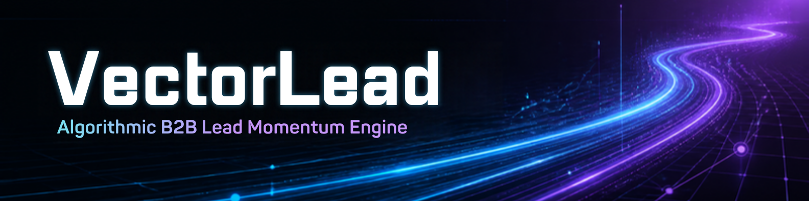
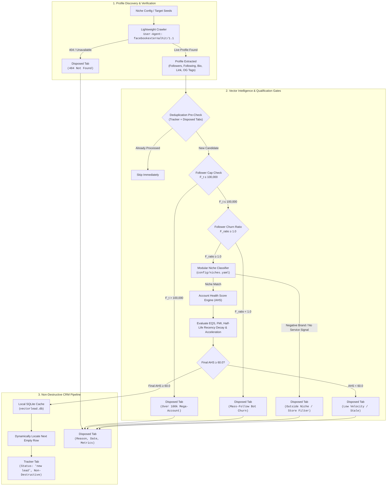
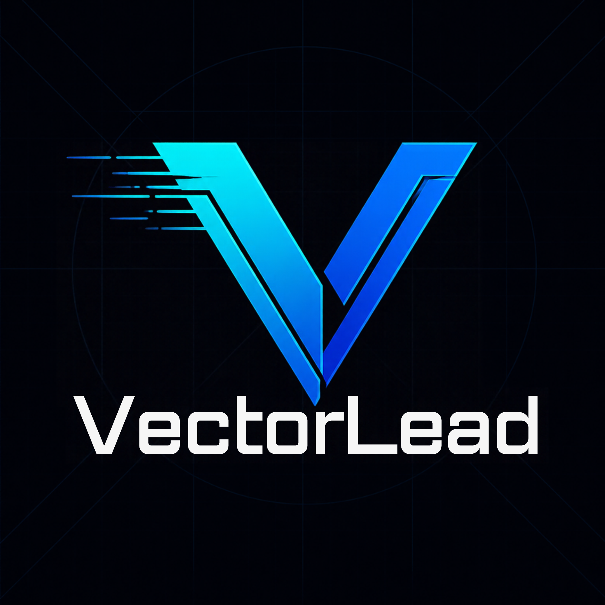

<div align="center">



# ⚡ VectorLead

### Autonomous Instagram Lead Discovery, Momentum Scoring, and CRM Sync Engine

[](https://github.com/your-org/vectorlead/actions/workflows/ci.yml)
[](https://www.python.org/)
[](https://github.com/psf/black)
[](http://mypy-lang.org/)
[](https://opensource.org/licenses/MIT)
[]()
[](http://makeapullrequest.com)

**Algorithmic B2B outreach without hallucination, account bans, or $100/mo API bills.**

[Features](#-key-features) • [Architecture](#-architecture) • [Mathematical Momentum Formula](#-mathematical-momentum-engine-ahs) • [Quickstart](#-3-step-quickstart) • [Google Sheets Setup](#-google-sheets-crm-setup) • [CLI Reference](#-cli-reference) • [Design Assets](#-canva-design-assets)

---

</div>

## 📌 Why VectorLead?

Traditional Instagram lead generation tools rely on brittle scraper architectures that churn through burner cookies, get hit with IP blocks, hallucinate inactive accounts, and fill CRM spreadsheets with 1M+ follower celebrity pages who never convert.

**VectorLead** introduces an institutional data architecture built on five quantitative pillars:

1. **Lightweight Crawler Verification (`facebookexternalhit/1.1`):** Safely parses OpenGraph meta properties without session cookies, proxy pools, or login credentials.
2. **Account Health Score (AHS) Momentum Matrix:** 35-day rolling formula balancing follower growth, reel view velocity, and comment velocity.
3. **Engagement Quality Score (EQS) & Pod Detection:** Analyzes Comment-to-Like ratios and creator response rates to filter out purchased engagement and spam pods.
4. **Funnel Maturity Index (FMI):** Inspects bio link destinations (Calendly, Typeform, Skool, Kajabi, Stan Store) and detects ManyChat DM keyword automations.
5. **Follower-to-Following Churn Filter ($F_{\text{ratio}}$):** Instantly rejects mass follow/unfollow churn bots.
6. **Non-Destructive Google Sheets CRM:** Guarantees $O(1)$ deduplication across `Tracker` and `Disposed` tabs with dynamic first-empty-row appending.

---

## 🏛 Architecture



---

## 📐 Mathematical Momentum Engine (AHS)

VectorLead evaluates candidate velocity using a **multi-vector rolling momentum model** designed to surface active micro-coaches while penalizing stale creators and mass-follow bots.

### 1. Raw Metrics
- $g_7$: 7-day follower growth rate:
  $$g_7 = \frac{F_t - F_{t-7}}{\max(F_{t-7}, 1)}$$
- $R_v$: Reel view velocity ratio:
  $$R_v = \frac{v_{\text{med},7}}{\max(v_{\text{med},30}, 1)}$$
- $R_c$: Comment velocity ratio:
  $$R_c = \frac{c_{\text{med},7}}{\max(c_{\text{med},30}, 1)}$$
- $P_{\text{eff}}$: Effective post count with exponential half-life recency decay ($\lambda = 7\text{ days}$):
  $$P_{\text{eff}} = P_{30} \times e^{-\frac{\max(0,\, D_{\text{last}} - 1)}{7}}$$
- $F_{\text{ratio}}$: Follower-to-following authenticity ratio:
  $$F_{\text{ratio}} = \frac{F_t}{\max(\text{Following}, 1)}$$
- $EQS$: Engagement Quality Score:
  $$S_{\text{EQS}} = \text{clamp}\left(\frac{c_{\text{med},7}}{\max(l_{\text{med},7}, 1)} \times 1000 + R_{\text{creator}} \times 25,\, 0,\, 100\right)$$

### 2. Component Scores (Clamped $0 \le S \le 100$)
$$S_G = \text{clamp}(g_7 \times 500,\, 0,\, 100)$$
$$S_V = \text{clamp}(R_v \times 50,\, 0,\, 100)$$
$$S_C = \text{clamp}(R_c \times 50,\, 0,\, 100)$$
$$S_P = \text{clamp}\left(\frac{P_{\text{eff}}}{12} \times 100,\, 0,\, 100\right)$$

### 3. Base Score Formulation
$$\text{Base AHS} = 0.35 S_G + 0.25 S_V + 0.20 S_C + 0.20 S_P$$
*(In advanced mode: $0.30 S_G + 0.20 S_V + 0.15 S_C + 0.15 S_P + 0.20 S_{\text{EQS}}$)*

### 4. Dynamic Multipliers Matrix ($M$)
$$M = M_{\text{tier}} \times M_{\text{churn}} \times M_{\text{funnel}} \times M_{\text{accel}}$$

| Vector | Factor | Condition | Multiplier Impact |
|:---|:---|:---|:---:|
| **Follower Tier** ($M_{\text{tier}}$) | Mega Account | $F_t > 100,000$ | **$0.00$** (Disqualified) |
| | Stale Account | $D_{\text{last}} > 14$ days | **$0.50$** (Dormancy penalty) |
| | Micro Sweet Spot | $2,000 \le F_t \le 40,000$ | **$1.20$** (Target operator) |
| | Mid-Tier | $40,000 < F_t \le 100,000$ | **$0.80 - 1.00$** (Linear scaling) |
| | Nano Creator | $F_t < 2,000$ | **$0.80$** (Baseline proof) |
| **Follower Churn** ($M_{\text{churn}}$) | Bot Churn | $F_t \ge 1,000 \land F_{\text{ratio}} < 1.0$ | **$0.00$** (Disqualified) |
| | Moderate Churn | $1.0 \le F_{\text{ratio}} < 2.0$ | **$0.85$** (Penalty) |
| | Organic Audience | $F_{\text{ratio}} \ge 2.0$ | **$1.00$** (Standard) |
| **Funnel Maturity** ($M_{\text{funnel}}$) | Tier A (High Ticket) | Calendly, Typeform, Skool, Kajabi, Stan Store | **$1.00$** |
| | Tier B (Multi-Link) | Linktree, Beacons, Bio.fm | **$0.95$** |
| | Tier C (Affiliate) | Amazon Storefront, LTK, discount codes | **$0.75$** |
| **Velocity Accel** ($M_{\text{accel}}$) | Breakout 🚀 | $\Delta R_v > 0.20$ | **$1.10$** (Breakout boost) |

### 5. Final Score & Gate
$$\text{Final AHS} = \text{Base AHS} \times M$$

$$\text{Qualified} \iff (\text{Final AHS} \ge 60.0) \land (M > 0.0)$$

---

## 🚀 3-Step Quickstart

### Step 1: Clone & Install
```bash
git clone https://github.com/your-org/vectorlead.git
cd vectorlead

# Install in editable mode (Python 3.11+)
pip install -e .
```

### Step 2: Configure Environment
Copy the environment template:
```bash
cp .env.example .env
```
*(If Google Cloud service credentials are not configured, VectorLead automatically falls back to an offline local CSV CRM mirror in `crm_data/` so you can start hunting immediately!)*

### Step 3: Run Your First Hunt
```bash
python main.py hunt --niche personal_trainer --min-new-leads 10
```

---

## 🎨 Canva Design Assets

The official VectorLead visual assets for GitHub headers and avatars were created in Canva and are exported directly inside `assets/`:

| Asset | Preview | Editable Canva Link |
|---|:---:|---|
| **Logo** |  | [Open Logo in Canva](https://canva.link/ugufzjndx730b6j) |
| **Repository Banner** |  | [Open Banner in Canva](https://canva.link/id8hpsyvksy2ivc) |

---

## 📊 Google Sheets CRM Setup

VectorLead provides production-grade, zero-loss syncing to Google Sheets:

### 1. Create a Google Cloud Service Account
1. Open [Google Cloud Console](https://console.cloud.google.com/).
2. Create a new project (e.g. `vectorlead-engine`).
3. Enable the **Google Sheets API** and **Google Drive API**.
4. Go to **IAM & Admin > Service Accounts** and click **Create Service Account**.
5. Assign the role **Editor**.
6. Under the **Keys** tab, click **Add Key > Create new key > JSON**.
7. Download and save the file as `service_account.json` in the project root.

### 2. Share Your Spreadsheet
1. Create a new Google Sheet named `VectorLead CRM Tracker`.
2. Click **Share** and add your service account email (e.g. `vectorlead-sync@project.iam.gserviceaccount.com`) as an **Editor**.
3. Copy the Spreadsheet ID from the URL:
   `https://docs.google.com/spreadsheets/d/`**`<YOUR_SPREADSHEET_ID>`**`/edit`
4. In `.env`, set:
   ```env
   GOOGLE_SERVICE_ACCOUNT_PATH=service_account.json
   GOOGLE_SHEET_ID=your_spreadsheet_id_here
   ```

### 3. Canonical Sheet Schema
VectorLead automatically provisions the required tabs if they do not exist:

#### `Tracker` Tab (Qualified Prospects: Final AHS $\ge 60.0$)
| Column | Description | Format |
|---|---|---|
| **A: Username** | Clean Instagram handle (no `@`) | `alex_hypertrophy_coach` |
| **B: AHS** | Final momentum score | `86.7` |
| **C: Outreach Date** | Empty for manual sales rep tracking | `""` |
| **D: Status** | Initial CRM pipeline stage | `"new lead"` |
| **E: Days Since Outreach** | Empty formula placeholder | `""` |
| **F: Notes** | Direct clickable link | `https://www.instagram.com/<username>/` |

#### `Disposed` Tab (Disqualified Leads: Never Re-Scraped)
| Column | Description | Format |
|---|---|---|
| **A: Username** | Clean handle | `mega_fitness_celeb` |
| **B: Followers** | Follower count | `1,450,000` |
| **C: Reason** | Exact disqualification rationale | `"Followers exceed cap (100,000)"` |
| **D: Disposed Date** | UTC timestamp | `2026-11-07 15:49:51` |
| **E: Notes** | Direct profile link | `https://www.instagram.com/<username>/` |

---

## 💻 CLI Reference

### 1. `hunt`: Continuous Quota Batch Discovery
Continuously crawls, qualifies, and syncs until `--min-new-leads` are added to your CRM:
```bash
# Hunt 10 personal trainers with follower cap of 100k
python main.py hunt --niche personal_trainer --min-new-leads 10 --max-followers 100000

# Hunt real estate agents with custom minimum AHS
python main.py hunt --niche realtor --min-new-leads 15 --min-ahs 65.0

# Process custom seed handles from a text file
python main.py hunt --niche personal_trainer --seeds prospects.txt

# Force local offline CSV mirror (crm_data/Tracker.csv)
python main.py hunt --niche ecommerce --min-new-leads 10 --local-crm
```

### 2. `test-account`: Single Profile Diagnostic
Run a complete algorithmic audit on any creator handle:
```bash
python main.py test-account coachmikemiller --niche personal_trainer
```
Output includes:
- Live zero-login crawl verification status
- Extracted bio, follower count, following, and post metrics
- Follower Churn Ratio ($F_{\text{ratio}}$)
- Funnel Maturity Tier (High Ticket, Multi-link, Affiliate)
- Engagement Quality Score (EQS)
- Breakout velocity acceleration detection (🚀)
- Composite multiplier and final outreach decision

### 3. `stats`: Local Cache & Pipeline Totals
Query your SQLite database (`vectorlead.db`) and CRM sheet row counts:
```bash
python main.py stats
```

### 4. `list-niches`: Modular Engine Inspector
List all niches loaded from `config/niches.yaml` with positive/negative rule counts:
```bash
python main.py list-niches
```

---

## ⚙️ Modular Niche Configuration (`config/niches.yaml`)

Add or customize niches effortlessly in YAML without touching Python code:

```yaml
niches:
  saas_consultant:
    name: "B2B SaaS Growth & Fractional Executive"
    positive_keywords:
      - "b2b consultant"
      - "fractional cmo"
      - "sales consultant"
      - "growth advisor"
    service_indicators:
      - "book a discovery call"
      - "audit your funnel"
      - "apply below"
      - "link in bio"
    negative_keywords:
      - "freelance marketplace"
      - "software download"
      - "free trial"
      - "job board"
      - "recruiting firm"
```

---

## 🧪 Running Unit Tests

VectorLead comes with a 100% passing test suite covering mathematical boundaries, zero-division protection, niche classification logic, and non-destructive CRM appending:

```bash
# Run all tests
pytest -v

# Run with coverage report
pytest --cov=src --cov-report=term-missing tests/
```

---

## 🛡 License

Released under the [MIT License](LICENSE). Built for growth engineers, B2B agency founders, and autonomous agent builders.
